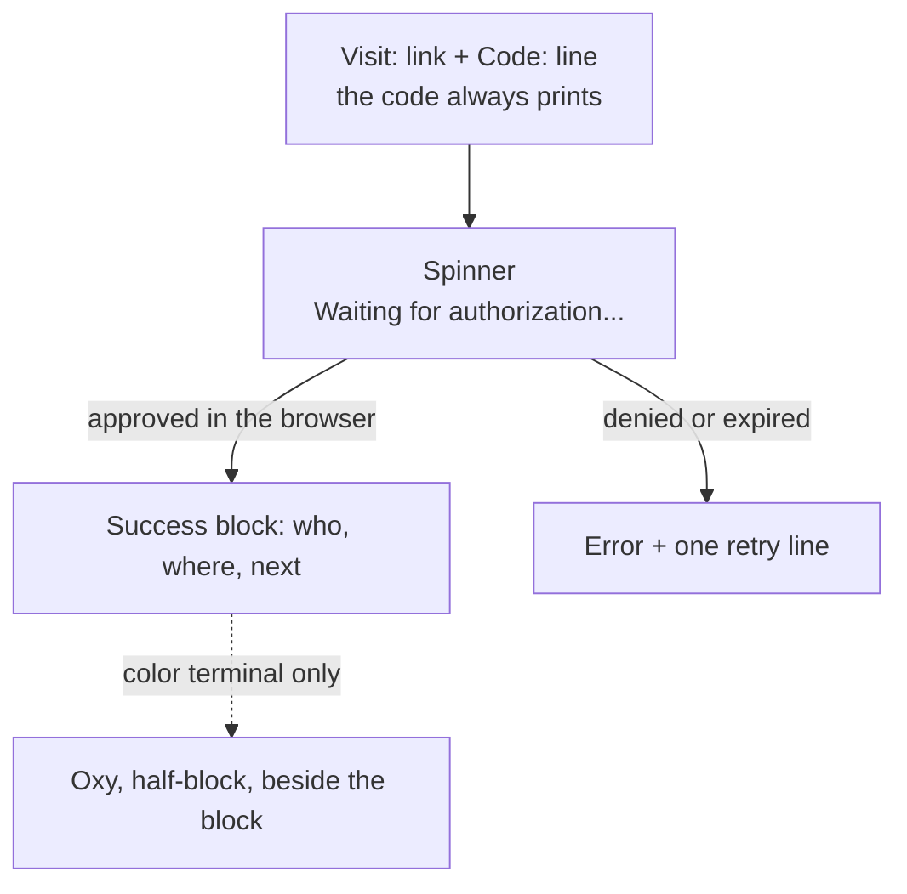

# Pattern · `ox login` flow

How the OAuth device flow composes catalog primitives.

## Composition



What a person sees, with the code to match and the three lines after it:

```
Visit: https://sageox.ai/device?user_code=WXYZ-1234
Code:  WXYZ-1234  (match this in your browser)

✓ Welcome back, Person (person.a@company.test)
  Endpoint: sageox.ai
  Next:     ox init
```

A first sign-in on an endpoint says `Welcome`, not `Welcome back`. A denied or expired request ends:

```
Error: authentication failed: authorization was denied
  Nothing was shared. Run `ox login` to try again
```

## Key decisions

- **The code always prints.** The approval page says "allow only if it matches the code your terminal shows" (RFC 8628). Hiding it turns that check into a click.
- **Success is three lines.** Who, where, what's next. Next is always `ox init`: no rotating tip, no disclaimer, no wordmark. Login is a step, not a destination.
- **"Welcome back" is earned.** Only when ox held a stored login for this account on this endpoint before the flow ran.
- **Oxy is for a person at a color terminal.** Everyone else gets the same three lines, byte for byte.
- **Failures get one retry line.** Denied and expired both end with the command to run again.

<details>
<summary>More: spinner, browser, Oxy's rules</summary>

- **Bubbletea, but minimal.** `loginSpinnerModel` is one spinner, one message, one `Ctrl+C` handler. On success it leaves no line behind: the success block prints right after it.
- **Browser-first.** `cli.OpenInBrowser` opens the URL (headless-safe). The spinner only polls; it has no UI to redirect to.
- **Ctrl+C means cancel, not "kill ox".** The model exits cleanly and the person can retry.
- **A different account is a new person.** Same machine, same endpoint, different user: "Welcome", not "Welcome back".
- **No Oxy in** a pipe, CI, an AI coworker's run, `--quiet`, `--json`, `--no-input`, `--no-interactive`, or under `NO_COLOR`. The art is one half-block confetti still from `internal/pet`.

</details>

## Source

- [`cmd/ox/login.go`](../../../cmd/ox/login.go) — `runLoginFlow`, `loginSpinnerModel`
- [`cmd/ox/login_arrival.go`](../../../cmd/ox/login_arrival.go) — retry lines, the "Welcome back" signal, when Oxy may appear
- [`internal/cli/login_arrival.go`](../../../internal/cli/login_arrival.go) — the code lines and the success block
- [`internal/pet/terminal.go`](../../../internal/pet/terminal.go) — `TerminalFrame`, Oxy as half-block text
- [`internal/cli/output.go`](../../../internal/cli/output.go) — `OpenInBrowser`

## Components used

[Spinner](../components/spinner.md) (the wait loop) · [Login screen](../components/login-screen.md) (every state, as one catalog snapshot)

## Related patterns

The `ox init` [wizard](init-wizard.md) is the natural next step after `ox login`.
