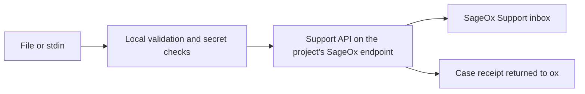

# Send feedback to SageOx

Use `ox feedback` when a command fails, confuses you, or makes your AI coworker do unnecessary work. Reports are private correspondence with SageOx Support.

Write a report in a file. Its first line is the title (8–200 characters); the whole report must fit within 4 KiB and 4,000 characters.

```sh
ox feedback --type bug --file report.txt --dry-run
ox feedback --type bug --file report.txt --json
```

The first command prints the exact JSON body without sending it or contacting authentication services. The second submits it using your login. To submit without login, supply a reply address:

```sh
cat report.txt | ox feedback --file - --email person@example.com
```

`--email` submits without using stored credentials, so it also works when login is broken. Categories are `bug`, `feature-request`, and `feedback` (the default). Report text is accepted through files and stdin, never as positional arguments.

## What is sent

- **Report:** Your supplied text and category.
- **Product facts:** ox version, operating system, and architecture.
- **Reply address:** The supplied email, or your account's notification address when using login.
- **Authentication:** Your endpoint's access token when using login. Refresh tokens are never used to submit a report.

No logs, environment variables, repository identifiers, or session content are collected automatically. Potential secrets stop submission locally. `--dry-run` uses the bundled secret checks offline; submission also loads current checks and refuses to send if they are unavailable. Review your supplied text before sending.

Explicit feedback works when telemetry is disabled. This command is separate from automatic error telemetry and from saved-plan review (`ox plan feedback`).

## Where it goes



The CLI posts JSON to `POST /api/v1/support/cases` on the endpoint selected for the current project. The support service resolves the reply address and sends the report to SageOx Support. It returns a `case_id`, which ox prints as a receipt:

```json
{
  "id": "sup_0123456789abcdefab",
  "status": "sent",
  "guidance": "SageOx Support accepted the report. Keep this receipt for follow-up."
}
```

A receipt means the support service accepted the report; it does not promise an inbox delivery time or a response time. Submission does not create a public GitHub issue.

## If submission fails

Keep the original report. The command does not queue it locally or retry automatically. If the connection fails after sending, delivery is uncertain: retrying can send a duplicate. An invalid or missing receipt is a failure, never a successful submission.

This release provides the basic report command. Diagnostic bundles, session attachments, and public issue filing are not included.
