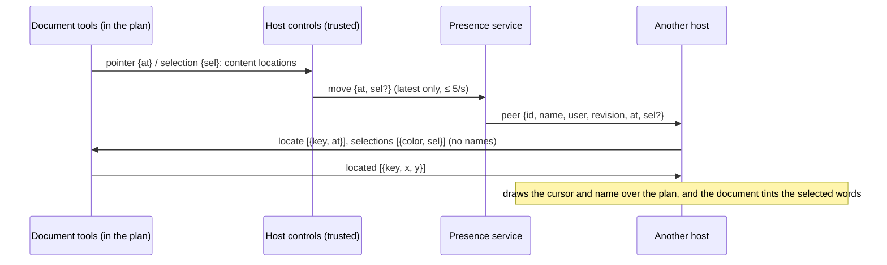

# Plan review: live presence, shared pointers and selections

**Status:** client side implemented (#1527): `@sageox/plan-review` 0.8.0
shares, places and draws pointers in both hosts, and `ox plan review` joins
its page to the plan's presence room. 0.12.0 adds selections: the words a
reviewer selects are tinted, in their color, on every other page on the same
revision. The presence service that relays them is a separate implementation
of section 4; until a service answers, the review page reads and reviews as
it did before.

**Goal:** an author reviewing a saved plan in `ox plan review` sees a
teammate's pointer moving over the plan, with their name, and the words they
select, while that teammate reviews the same plan on a hosted viewer, and the
teammate sees the author's. Two `ox plan review` pages on the same saved plan
see each other the same way. Opening the plan is enough: no screen share, no
Ledger sync, no reload.



## 1. A pointer is content, not a screen position

A pointer location (`PointerAt` in `packages/plan-review/src/protocol.ts`)
names what lies under the pointer:

| Field | Meaning |
|---|---|
| `anchor` | The innermost markable element under the pointer: its `h` content anchor, the one review marks use (`anchor.ts`) |
| `nth`, `of` | When that anchor occurs more than once: which occurrence, of how many. Both or neither; `of` ≥ 2 |
| `path` | Child-element indexes from that element down to the element under the pointer, skipping the review layer's own marks and markup that never renders. At most 16 steps |
| `x`, `y` | The pointer's place in that element's box, as fractions in [0, 1] |
| `text` | Over words: how many non-space characters of the markable element precede the pointer |

The document places a location on its own render by finding the element by
anchor (and occurrence), then, in order: the character `text` counts to; else
the element at `path`, at `x`, `y` in its box. Since an anchor hashes the
element's text and its section heading, the location names the same words at
any width, zoom and scroll position, and a reflow that moves those words moves
the pointer with them.

A pointer that cannot be placed reliably is not drawn: no element has its
anchor or its path leads nowhere, the anchor occurs a different number of
times than it did for the sender, the content is collapsed (a closed
`<details>`, an unchecked tab), not rendered or clipped, or the point is off
screen. A plan that keeps changing, such as one with a ticking clock, has its
anchors hashed again at most every 250 ms, not on every change.

`pkg/planreview/testdata/presence/pointers.json` holds the cases every reader
applies: the package's `pointerAt`, the `ox plan review` bridge (section 5),
and a presence service.

### A selection is two places in the text

A selection (`SelectionAt`) is `{start, end}`, the first and last selected
places, in document order. Each is a `TextAt`, named the way a pointer's
words are, and never carries the selected words themselves:

| Field | Meaning |
|---|---|
| `anchor` | The markable element holding the place: its `h` content anchor |
| `nth`, `of` | As for a pointer: which occurrence of a repeated anchor, of how many |
| `text` | How many non-space characters of that element precede the place; required, at most 1048576 |

A selection's edges skip whitespace, and any words outside every markable
element: a selection that starts in a `<summary>` on an authored page, which
is not markable, is shared from the first markable words after it. The
document places each end on its own render, a start just before the character
`text` counts to and an end just past the one before it, and tints the range
between them with the CSS Custom Highlight API, so the tint follows the words
through any scroll or reflow without being placed again. A selection is not
tinted when an end names an element this render lacks, one whose anchor
occurs a different number of times than for the sender, or one with fewer
characters, or when its ends are inverted. Selected words inside content
collapsed on this render stay in the range, and the browser paints none of
them until they show. `pkg/planreview/testdata/presence/selections.json` holds the
cases every reader applies.

## 2. The frame boundary

A host that frames a plan in an opaque-origin sandbox keeps names,
connections and credentials on its side, as for every other review message.
Five messages carry pointers and selections across the frame; each is checked
by `parseDocumentMessage` or `parseHostMessage` like the rest:

| Message | Direction | Content |
|---|---|---|
| `{type:'pointer', at}` | document → host | Where this reviewer's pointer rests, or `null` when it left the plan. Sent at most every 50 ms, and only when it changed |
| `{type:'locate', points}` | host → document | Up to 64 `{key, at}`: other reviewers' pointers to place. `key` is minted by the host (`p1`, `p2`, …), never a name or a connection id |
| `{type:'located', points}` | document → host | Each placed key, `{key, x, y}` in the document's viewport pixels; a key left out is not drawn. Sent again whenever a scroll, resize, toggle or content change moves one |
| `{type:'selection', sel}` | document → host | The words this reviewer has selected, or `null`. Sent at most every 50 ms, and only when it changed |
| `{type:'selections', items}` | host → document | Up to 64 `{color, sel}`: other reviewers' selections to tint, `color` one of the host's eight cursor colors (0–7), never a name. Sent only when the list changes, and again when the document loads |

The host draws each cursor and its name over the frame's box, clipped to it;
the document tints each selection, in the `rev-sel-c0` … `rev-sel-c7`
highlights `document.css` colors like the host's cursors. A plan's own script
can read `locate`, `located` and `selections`, so it can learn that some
reviewer points at or selects some content, and which of eight colors they
were given, never who. It can also answer `located`
itself and misplace a cursor within its own frame, or forge `pointer`, which
the host checks and sends no faster than any other pointer. A document that
goes away, by a reload or a navigation, reports its pointer gone as it
unloads, since nothing it sends afterwards is heard. The messages are
additive to protocol 3: a document or host from before 0.8.0 drops them, and
presence does not appear; one from before 0.12.0 drops the selection
messages, and shows pointers only.

## 3. The host

`mountHostControls` takes `presence`, a `PresenceTransport`, beside the
`revision` the page shows. The bar then lists who else has the plan open, one
chip per person in their cursor's color, and draws the pointers of those on
the same revision.

```ts
interface PresenceTransport {
  join(revision: string, on: (e: PresenceEvent) => void): PresenceLink;
}
interface PresenceLink {
  move(at: PointerAt | null, sel: SelectionAt | null): void | Promise<unknown>; // only the latest matters; a promise holds the next move until it settles
  leave(): void;
}
type PresenceEvent =
  | { type: 'welcome'; self: string; peers: Peer[] } // joined, or joined again: everyone here now
  | { type: 'peer'; peer: Peer }                     // someone joined or moved; the latest wins
  | { type: 'leave'; id: string }                    // someone left, or was expired
  | { type: 'lost' };                                // the connection dropped
interface Peer { id: string; name: string; user: string; revision: string; at: PointerAt | null; sel?: SelectionAt | null }
```

The transport authenticates as the signed-in reviewer and keeps the
connection up: after a drop it says `lost`, reconnects, and says `welcome`
again. The controls own the rest:

- **Revision.** A pointer is placed, and a selection tinted, only for a peer
  showing the same `revision`. A peer on another revision is listed as such
  ("Avery on another revision"), and neither is ever drawn on this one.
- **Rate and order.** This reviewer's pointer and selection travel together
  in one move, sent at most every 200 ms, one move at a time, coalesced to
  the latest of both, so a slow move is never overtaken by an older one. The
  cursor glides between places over the same 200 ms.
- **Color.** A peer's selection is tinted in their cursor's color, the color
  of their chip in the bar.
- **Transient.** Nothing is stored: no outbox, no `localStorage`, no Ledger
  record. On `lost` every peer is forgotten; on `welcome` the controls send
  where the pointer is now, never the moves made while disconnected.
- **Self.** Events about the controls' own connection (`self`) are ignored.
- **Identity.** A peer's `name` is shown as text, never as markup; a peer
  whose fields are malformed, `sel` included, is dropped.

A host without a presence service passes no `presence`, and the controls
behave exactly as before.

## 4. The presence service

The contract a service implements for both hosts. Paths are relative to the
SageOx API base the CLI already uses.

**Join.** `GET /api/v1/plans/{plan_id}/presence?revision=<sha256:…>` with
`Authorization: Bearer <token>` and `Accept: text/event-stream`.

- `plan_id` is the saved plan's canonical `pln_` id; `revision` is the
  `sha256:` digest of the plan bytes the page shows (the `revision` review
  drawings are stamped with).
- `200` opens a stream that stays open, with a keepalive comment at least
  every 25 seconds. A client ends a stream that is silent for 75 seconds and
  joins again.
- `401`, `403` or `404`: the service declines this reviewer or plan. A client
  waits minutes before asking again. Any other failure is retried with backoff
  from one second to 30.
- The service resolves the plan and admits only callers allowed to see its
  reviewers; a link to the plan alone is not enough.

**Events**, each one SSE event with a JSON `data` line:

| `event:` | `data` |
|---|---|
| `welcome` | `{"self": "<connection id>", "peers": [Peer, …]}`, first on every stream |
| `peer` | a Peer: `{"id", "name", "user", "revision", "at", "sel"}`, on every join and move; `sel` only while that connection has a selection |
| `leave` | `{"id": "<connection id>"}`, when a stream closes or the service expires it |

`name` is the account's display name, never empty (the service supplies one
for an account without), and `user` a stable key for the account, both from
the token the connection joined with, never from anything a client sends. `id`, `user` and `revision` are at most 128 characters, `name` at most
200, an event's data at most 256 KiB. A client ignores events about its own
`self`, and fields it does not know: one peer carrying a field a client
predates must not fail the whole `welcome`.

**Move.** `POST /api/v1/plans/{plan_id}/presence/{connection}` with the same
token and `{"at": PointerAt | null, "sel": SelectionAt | null}`. `sel` is
optional, and a client omits it while nothing is selected, so a pointer-only
move is the same bytes as before selections. The service checks the token
owns the connection, checks `at` and `sel` by section 1, and relays them as a
`peer` event. A move replaces the connection's whole state: one without `sel`
clears its selection. A
client sends at most 5 moves a second per connection; a service may drop
faster ones. A move is fire-and-forget: a client ignores its failures, since
the next move or the next `welcome` carries the pointer again.

**Lifecycle.** The stream is the connection: it lasts while its stream is
open, and a service that ends a connection, on expiry or lost access, closes
its stream, which the client joins again. Each tab is its own connection:
closing a stream leaves only that one, and the service tells the others with
`leave`. A connection whose stream is gone without a close, such as one held
by a server that crashed, is expired within about a minute.

**Nothing is kept.** Pointer positions and selections are never written to a
database, the Ledger, analytics or logs, and a reconnect starts from current
presence, not a replay.

## 5. `ox plan review`

The review page is served by a localhost server that holds no account
credentials in the page. The server joins the room on the page's behalf, as
the user signed in with `ox login`:

| Page → server | Server → service |
|---|---|
| `GET /events?t=<review token>&rev=<revision>&k=<page key>`: the live-reload stream, which also carries the room's events as `event: presence` | one join per open page, for the plan the server serves |
| `POST /presence` with `X-Review-Token` and `{"key", "at", "sel"}` | the page's latest pointer and selection, at most every 200 ms; `sel` only when there is one |

- The server joins only the saved plan it serves, by the `pln_` id in its
  event log. The page names its revision and a key, never a plan, room, path
  or identity; `/presence` refuses unknown fields and malformed pointers and
  selections.
- A page whose stream closes leaves the room, and a page whose server is
  gone stops showing anyone until it is back. When the review loop ends
  (Approve, idle, Ctrl-C), the server closes the pages' streams, so they leave
  the room and the command exits even with a tab open. A pointer move writes
  nothing, reloads nothing, and does not keep an idle review loop open.
- With no login for the project's endpoint, or no `pln_` id (a plan saved
  before ids existed), the server makes no presence request at all, and the
  page carries none of it. A declined join is asked again only after five
  minutes, and so is one whose login the auth server rejects; a login refresh
  lost on the network is retried like any transient failure. Reading, drafts,
  submission and Approve never wait on presence.

## 6. Revisions across hosts

A pointer is drawn, and a selection tinted, only between pages showing the
same revision. For an
authored HTML plan, `ox plan review` and a host that frames the stored
`plan.html` show the same bytes, so the same revision. For a markdown plan,
`ox plan review` renders its page from `plan.md` and names that revision,
while a host that frames the stored render names the render's: each lists the
other on another revision, and draws no pointer or selection. Two `ox plan
review` pages on one markdown plan see each other's pointers and selections.

## 7. Evidence

| Test | Proves |
|---|---|
| `TestBrowser_LocalAndFramedReviewersSeeEachOthersPointers` | A local page (1280 px) and a framed host (an offset frame in a 1000 px window) see each other's named pointer on the same word, through a scroll; a pointer in a section collapsed on the other side is drawn only once it is opened there; each tints exactly the words the other selects, across elements and at its own width, in the other's color, from the first markable words, and clears them when they are let go; the framed plan hears no name or connection id; a reload leaves one cursor, not a ghost; a reloaded frame leaves no stale pointer; with its server gone, the page shows no one |
| `TestBrowser_PointerOnAnotherRevisionIsNeverDrawn` | Two local pages on one plan, on different revisions, list each other as on another revision and never draw each other's pointer |
| `TestReviewLoop_PresenceRelaysTheRoomBothWays` | The server relays joins, moves, selections and leaves between a page and a hosted viewer, under the service's names; a move with nothing selected carries no `sel`; a second tab leaves alone; live reloads share the stream |
| `TestReviewLoop_PresenceMovesAreCheckedAndScoped` | `/presence` refuses a missing token, a name, extra fields (the selected words among them), out-of-range values, half a selection, a key with no open stream, and oversized bodies |
| `TestPresenceBridge_RejoinSendsOnlyTheCurrentPointer` | A dropped connection says `lost`, rejoins, and sends only the current pointer |
| `TestPresenceBridge_ReconnectingPageReplacesItsConnection` | A page reconnecting under its key leaves the room once, not twice |
| `TestPresenceBridge_JoinsWithTheCurrentLogin` | A rejoin uses the login on disk, so signing in anew takes effect |
| `TestBrowser_PointerMovesNeverOverlap` | The controls send one move at a time, then the latest |
| `TestBrowser_ChangingPlanIsNotRehashedEveryFrame` | A plan rewriting itself every 16 ms is hashed a few times a second, not every frame |
| `TestPlanReview_ReportsHowTheSessionEnded` | A review session ends, and exits, with the reviewer's tab still open |
| `TestPresenceBridge_RetriesOnlyWhatMayRecover` | Declined joins are not retried soon; transient failures are; a silent stream is dropped and joined again |
| `TestNewPresenceBridge_OnlyForASavedPlanAndASignedInUser` | No login or no `pln_` id: no bridge and no request; a refresh lost on the network is retried soon, a rejected login waits |
| `TestPresence_SharedCases`, `protocol.test.mjs` | The Go bridge and the package apply the same pointer and selection rules |

`fakePresence` in `cmd/ox/plan_review_presence_test.go` is a section 4
service for one plan, used by these tests.

## 8. Not covered

- **The presence service itself** is a separate implementation; end-to-end
  acceptance against it is pending that work and a released package.
- **Touch** pointers are not shared: a finger scrolls and taps, it does not
  hover.
- **Off-screen peers** are listed in the bar but have no edge indicator.
- **Words outside every markable element** at a selection's edge are not
  shared, the same content a pointer cannot name.
- **A selection is one range.** Dragged across content collapsed on the
  reviewer's page, such as a closed `<details>` or a hidden tab, it still
  covers that content, and a teammate who has it open sees it tinted.
- **A selection in review mode** is shared only while it lasts: once the
  reviewer clicks into the note it opened, the page has no selection, and
  teammates see none, though the note is about those words.
- **A browser without the CSS Custom Highlight API** shares its reviewer's
  selection but tints no one else's.
- **A host that mounts the review controls only for review** shows presence
  only while they are mounted.
