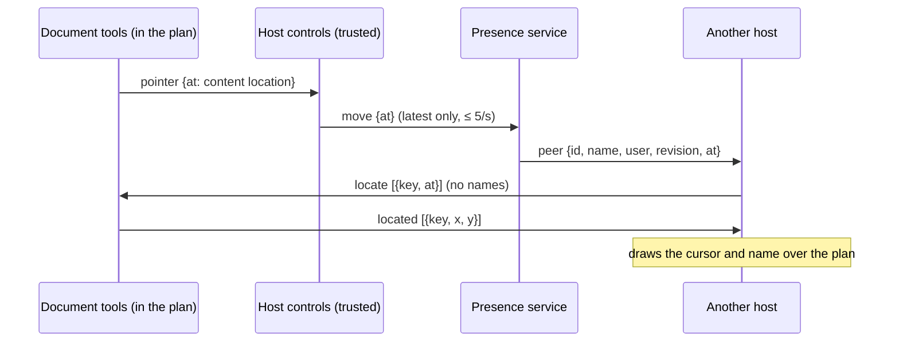

# Plan review: live presence and shared pointers

**Status:** client side implemented (#1527): `@sageox/plan-review` 0.8.0
shares, places and draws pointers in both hosts, and `ox plan review` joins
its page to the plan's presence room. The presence service that relays them
is a separate implementation of section 4; until a service answers, the
review page reads and reviews as it did before.

**Goal:** an author reviewing a saved plan in `ox plan review` sees a
teammate's pointer moving over the plan, with their name, while that teammate
reviews the same plan on a hosted viewer, and the teammate sees the author's.
Two `ox plan review` pages on the same saved plan see each other the same
way. Opening the plan is enough: no screen share, no Ledger sync, no reload.



## 1. A pointer is content, not a screen position

A pointer location (`PointerAt` in `packages/plan-review/src/protocol.ts`)
names what lies under the pointer:

| Field | Meaning |
|---|---|
| `anchor` | The innermost markable element under the pointer: its `h` content anchor, the one review marks use (`anchor.ts`) |
| `nth`, `of` | When that anchor occurs more than once: which occurrence, of how many. Both or neither; `of` ≥ 2 |
| `path` | Child-element indexes from that element down to the element under the pointer, skipping the review layer's own marks and markup that never renders. At most 16 steps |
| `x`, `y` | The pointer's place in that element's box, as fractions in [0, 1] |
| `text` | Over words: how many non-space characters of the markable element precede the pointer |

The document places a location on its own render by finding the element by
anchor (and occurrence), then, in order: the character `text` counts to; else
the element at `path`, at `x`, `y` in its box. Since an anchor hashes the
element's text and its section heading, the location names the same words at
any width, zoom and scroll position, and a reflow that moves those words moves
the pointer with them.

A pointer that cannot be placed reliably is not drawn: no element has its
anchor or its path leads nowhere, the anchor occurs a different number of
times than it did for the sender, the content is collapsed (a closed
`<details>`, an unchecked tab), not rendered or clipped, or the point is off
screen.

`pkg/planreview/testdata/presence/pointers.json` holds the cases every reader
applies: the package's `pointerAt`, the `ox plan review` bridge (section 5),
and a presence service.

## 2. The frame boundary

A host that frames a plan in an opaque-origin sandbox keeps names,
connections and credentials on its side, as for every other review message.
Three messages carry pointers across the frame; each is checked by
`parseDocumentMessage` or `parseHostMessage` like the rest:

| Message | Direction | Content |
|---|---|---|
| `{type:'pointer', at}` | document → host | Where this reviewer's pointer rests, or `null` when it left the plan. Sent at most every 50 ms, and only when it changed |
| `{type:'locate', points}` | host → document | Up to 64 `{key, at}`: other reviewers' pointers to place. `key` is minted by the host (`p1`, `p2`, …), never a name or a connection id |
| `{type:'located', points}` | document → host | Each placed key, `{key, x, y}` in the document's viewport pixels; a key left out is not drawn. Sent again whenever a scroll, resize, toggle or content change moves one |

The host draws each cursor and its name over the frame's box, clipped to it.
A plan's own script can read `locate` and `located`, so it can learn that some
reviewer points at some content, never who. It can also answer `located`
itself and misplace a cursor within its own frame, or forge `pointer`, which
the host checks and sends no faster than any other pointer. The messages are
additive to protocol 3: a document or host from before 0.8.0 drops them, and
presence does not appear.

## 3. The host

`mountHostControls` takes `presence`, a `PresenceTransport`, beside the
`revision` the page shows. The bar then lists who else has the plan open, one
chip per person in their cursor's color, and draws the pointers of those on
the same revision.

```ts
interface PresenceTransport {
  join(revision: string, on: (e: PresenceEvent) => void): PresenceLink;
}
interface PresenceLink {
  move(at: PointerAt | null): void; // only the latest matters: drop any not yet sent
  leave(): void;
}
type PresenceEvent =
  | { type: 'welcome'; self: string; peers: Peer[] } // joined, or joined again: everyone here now
  | { type: 'peer'; peer: Peer }                     // someone joined or moved; the latest wins
  | { type: 'leave'; id: string }                    // someone left, or was expired
  | { type: 'lost' };                                // the connection dropped
interface Peer { id: string; name: string; user: string; revision: string; at: PointerAt | null }
```

The transport authenticates as the signed-in reviewer and keeps the
connection up: after a drop it says `lost`, reconnects, and says `welcome`
again. The controls own the rest:

- **Revision.** A pointer is placed only for a peer showing the same
  `revision`. A peer on another revision is listed as such ("Avery on another
  revision"), and their pointer is never drawn on this one.
- **Rate.** This reviewer's pointer is sent at most every 200 ms, coalesced
  to its latest place; the cursor glides between places over the same 200 ms.
- **Transient.** Nothing is stored: no outbox, no `localStorage`, no Ledger
  record. On `lost` every peer is forgotten; on `welcome` the controls send
  where the pointer is now, never the moves made while disconnected.
- **Self.** Events about the controls' own connection (`self`) are ignored.
- **Identity.** A peer's `name` is shown as text, never as markup; a peer
  whose fields are malformed is dropped.

A host without a presence service passes no `presence`, and the controls
behave exactly as before.

## 4. The presence service

The contract a service implements for both hosts. Paths are relative to the
SageOx API base the CLI already uses.

**Join.** `GET /api/v1/plans/{plan_id}/presence?revision=<sha256:…>` with
`Authorization: Bearer <token>` and `Accept: text/event-stream`.

- `plan_id` is the saved plan's canonical `pln_` id; `revision` is the
  `sha256:` digest of the plan bytes the page shows (the `revision` review
  drawings are stamped with).
- `200` opens a stream that stays open, with a keepalive comment at least
  every 25 seconds. A client ends a stream that is silent for 75 seconds and
  joins again.
- `401`, `403` or `404`: the service declines this reviewer or plan. A client
  waits minutes before asking again. Any other failure is retried with backoff
  from one second to 30.
- The service resolves the plan and admits only callers allowed to see its
  reviewers; a link to the plan alone is not enough.

**Events**, each one SSE event with a JSON `data` line:

| `event:` | `data` |
|---|---|
| `welcome` | `{"self": "<connection id>", "peers": [Peer, …]}`, first on every stream |
| `peer` | a Peer: `{"id", "name", "user", "revision", "at"}`, on every join and move |
| `leave` | `{"id": "<connection id>"}`, when a stream closes or the service expires it |

`name` is the account's display name and `user` a stable key for the account,
both from the token the connection joined with, never from anything a client
sends. `id`, `user` and `revision` are at most 128 characters, `name` at most
200, an event's data at most 256 KiB. A client ignores events about its own
`self`.

**Move.** `POST /api/v1/plans/{plan_id}/presence/{connection}` with the same
token and `{"at": PointerAt | null}`. The service checks the token owns the
connection, checks `at` by section 1, and relays it as a `peer` event; a
connection it no longer has answers `404`. A client sends at most 5 moves a
second per connection; a service may drop faster ones.

**Lifecycle.** A connection lasts while its stream is open. Each tab is its
own connection: closing a stream leaves only that one, and the service tells
the others with `leave`. A connection whose stream is gone without a close,
such as one held by a server that crashed, is expired within about a minute.

**Nothing is kept.** Pointer positions are never written to a database, the
Ledger, analytics or logs, and a reconnect starts from current presence, not
a replay.

## 5. `ox plan review`

The review page is served by a localhost server that holds no account
credentials in the page. The server joins the room on the page's behalf, as
the user signed in with `ox login`:

| Page → server | Server → service |
|---|---|
| `GET /events?t=<review token>&rev=<revision>&k=<page key>`: the live-reload stream, which also carries the room's events as `event: presence` | one join per open page, for the plan the server serves |
| `POST /presence` with `X-Review-Token` and `{"key", "at"}` | the page's latest pointer, at most every 200 ms |

- The server joins only the saved plan it serves, by the `pln_` id in its
  event log. The page names its revision and a key, never a plan, room, path
  or identity; `/presence` refuses unknown fields and malformed pointers.
- A page whose stream closes leaves the room. A pointer move writes nothing,
  reloads nothing, and does not keep an idle review loop open.
- With no login for the project's endpoint, or no `pln_` id (a plan saved
  before ids existed), the server makes no presence request at all, and the
  page carries none of it. A declined join is asked again only after five
  minutes; reading, drafts, submission and Approve never wait on presence.

## 6. Revisions across hosts

A pointer is drawn only between pages showing the same revision. For an
authored HTML plan, `ox plan review` and a host that frames the stored
`plan.html` show the same bytes, so the same revision. For a markdown plan,
`ox plan review` renders its page from `plan.md` and names that revision,
while a host that frames the stored render names the render's: each lists the
other on another revision, and draws no pointer. Two `ox plan review` pages
on one markdown plan see each other's pointers.

## 7. Evidence

| Test | Proves |
|---|---|
| `TestBrowser_LocalAndFramedReviewersSeeEachOthersPointers` | A local page (1280 px) and a framed host (an offset frame in a 1000 px window) see each other's named pointer on the same word, through a scroll; a pointer in a section collapsed on the other side is drawn only once it is opened there; the framed plan hears no name or connection id; a reload leaves one cursor, not a ghost |
| `TestBrowser_PointerOnAnotherRevisionIsNeverDrawn` | Two local pages on one plan, on different revisions, list each other as on another revision and never draw each other's pointer |
| `TestReviewLoop_PresenceRelaysTheRoomBothWays` | The server relays joins, moves and leaves between a page and a hosted viewer, under the service's names; a second tab leaves alone; live reloads share the stream |
| `TestReviewLoop_PresenceMovesAreCheckedAndScoped` | `/presence` refuses a missing token, a name, extra fields, out-of-range values, another page's key, and oversized bodies |
| `TestPresenceBridge_RejoinSendsOnlyTheCurrentPointer` | A dropped connection says `lost`, rejoins, and sends only the current pointer |
| `TestPresenceBridge_RetriesOnlyWhatMayRecover` | Declined joins are not retried soon; transient failures are; a silent stream is dropped and joined again |
| `TestNewPresenceBridge_OnlyForASavedPlanAndASignedInUser` | No login or no `pln_` id: no bridge and no request |
| `TestPresenceAt_SharedCases`, `protocol.test.mjs` | The Go bridge and the package apply the same pointer rules |

`fakePresence` in `cmd/ox/plan_review_presence_test.go` is a section 4
service for one plan, used by these tests.

## 8. Not covered

- **The presence service itself** is a separate implementation; end-to-end
  acceptance against it is pending that work and a released package.
- **Touch** pointers are not shared: a finger scrolls and taps, it does not
  hover.
- **Off-screen peers** are listed in the bar but have no edge indicator.
- **A host that mounts the review controls only for review** shows presence
  only while they are mounted.
